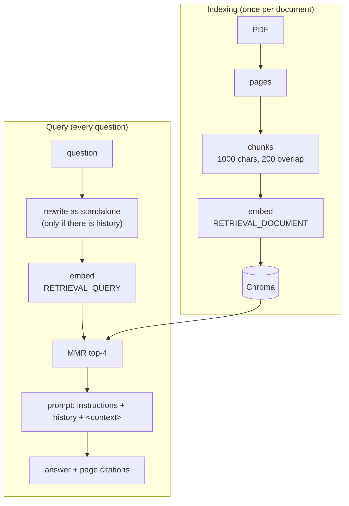

# 03 · Document Question Answering (RAG)

Ask questions about an uploaded PDF. The app retrieves the most relevant
passages and answers from them, with page citations. The model can now use
knowledge that was never in its training data.

```bash
streamlit run 03-rag/app.py
```

## Architecture



## Design decisions

**Content-based document identity.** Uploads are identified by a SHA-256
hash of their bytes. A different file with the same name is re-indexed; an
identical re-upload is not embedded twice.

**One Chroma collection per document.** The in-memory Chroma client is
shared by the whole Python process. The original version had two bugs here:
a second PDF was silently ignored, and reusing the default collection could
mix old chunks into new answers. Each upload now gets a uniquely named
collection and the previous one is deleted. A regression test covers this.

**Chunk overlap.** Like overlapping charts in an atlas, overlapping chunks
make sure a sentence on a boundary is fully contained in at least one chunk.

**MMR instead of plain top-k.** Overlapping chunks have nearly identical
embeddings, so plain top-k can return three copies of one passage. Maximal
marginal relevance picks passages that are relevant to the query but not
redundant with each other:

$$\text{MMR} = \arg\max_{d \in R \setminus S} \Big[\lambda \cdot \text{sim}(d, q) - (1-\lambda) \max_{d_j \in S} \text{sim}(d, d_j)\Big]$$

Geometrically: points on the sphere close to the query but far from each
other.

**Asymmetric task types.** Gemini embeds chunks with `RETRIEVAL_DOCUMENT`
and questions with `RETRIEVAL_QUERY`. Chroma already calls `embed_documents`
and `embed_query` separately, so the shared config handles this with no code
in the app.

**Conversation history is solved in two places.**
1. *Generation:* recent history is passed to the model, so it can refer to
   earlier answers.
2. *Retrieval:* a follow-up such as "and the second one?" is meaningless on
   its own and would retrieve unrelated chunks. When there is history, the
   model first rewrites the question as a standalone query, and that query
   is embedded. The app shows the rewritten query under the answer.

**Prompt structure.** Instructions go in the system message; retrieved text
goes in a delimited `<context>` block and is declared to be data. This makes
it harder for text inside the PDF to act as an instruction (prompt
injection), although it does not make it impossible.

**Grounding and citations.** Each chunk is tagged with its page number, the
model is told to cite pages and to say when the answer is not in the
document, and a "Sources" expander shows the retrieved passages.

**Scanned PDFs.** A PDF with no text layer produces no chunks. The app
reports that OCR would be needed instead of answering from nothing.

## Known limitations and next steps

- Dense retrieval only. Exact matches (codes, numbers, names) would benefit
  from hybrid search (BM25 + embeddings) and a cross-encoder reranker.
- No quantitative evaluation yet. Retrieval and generation should be
  measured separately, e.g. context precision/recall and faithfulness
  (RAGAS).
- The vector store is in memory and per session; many users or many
  documents would need a persistent vector database.
