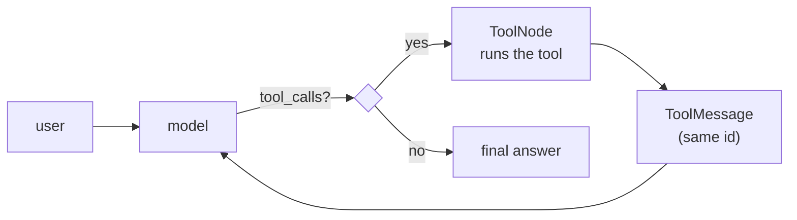

# 04 · Tool-calling Agent

The model gets three tools (a calculator, Wikipedia and, optionally, Tavily
web search) and decides by itself which one to call, with which arguments.
The system moves from *talking* to *acting*.

```bash
streamlit run 04-tool-calling/app.py
```

## How tool calling actually works



**The model never runs a tool.**
1. `@tool` turns the function signature and docstring into a JSON Schema.
   That schema is all the model sees.
2. The model returns a structured request: tool name, arguments and an id.
3. The application runs the tool (LangGraph's `ToolNode`).
4. The result goes back as a `ToolMessage` with the same id.
5. The loop repeats until the model answers without calling a tool.

So **a tool's docstring is a prompt**: the model chooses tools by reading it.
`create_agent` builds this ReAct loop as a LangGraph graph with a cycle.

## Design decisions

**A safe calculator instead of `eval()`.** The original tool called
`eval(expression, {"__builtins__": {}})`. Emptying the builtins is not a
sandbox: object introspection can still escape it. "Pure arithmetic" can
also freeze the server, since `9**9**9` has hundreds of millions of digits.
[`llm_series/safe_math.py`](../llm_series/safe_math.py) parses the expression
into an AST and evaluates only whitelisted nodes (numbers, arithmetic
operators, a few constants and math functions). It also refuses powers with
more than 10,000 digits.

**`^` means power.** In Python `^` is XOR, so an LLM sending `2^3` used to
get 1 instead of 8, silently. The calculator now treats `^` as `**`.

**Errors are returned as text.** "Calculation error: …" goes back to the
model, which can fix its expression and try again (self-correction).

**Full history, including tool calls and results.** Earlier versions stored
only the final answer, so "multiply the number you found by 2" had nothing
to refer to. The complete message list is now kept. Gemini also expects its
own messages back unmodified, because they carry *thought signatures* that
multi-turn tool calling requires.

**Recursion limit.** At most 15 model and tool steps per question, so a model
that keeps calling tools cannot loop forever.

**Observability.** Every tool call and its arguments are shown in a
collapsible status box.

**Directive prompt, on purpose.** The system prompt says "always use the
calculator for math". Prompts are a soft constraint: in testing, models
sometimes skipped the calculator for simple arithmetic anyway. A hard guarantee would
need `tool_choice` or deterministic routing, at the cost of flexibility.
Project 05 takes the opposite approach with a neutral prompt.

## Security note

Web pages and Wikipedia articles are untrusted input. Text such as "ignore
your previous instructions" inside a search result can be mistaken for an
instruction (indirect prompt injection). These tools are read-only, which
limits the damage. Tools with side effects would need human approval.
