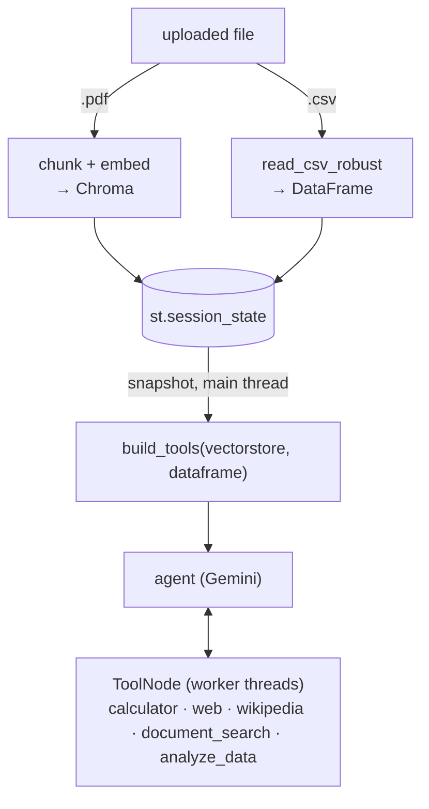

# 05 · Unified Agent: RAG + Tools + Data Analysis

One agent, five tools: `calculator`, `tavily_search` (optional),
`wikipedia`, `document_search` (RAG over an uploaded PDF) and `analyze_data`
(safe operations on an uploaded CSV). It brings the whole series together.

```bash
streamlit run 05-unified-agent/app.py
```

## Architecture



There are two separate decisions:
- **Pre-processing (deterministic):** the file extension routes a PDF to the
  vector store and a CSV to a DataFrame.
- **Tool selection (the model's call):** which data to look at, when.

## What changed from the earlier projects

| Earlier limitation | How it is solved here |
|---|---|
| 03: a second PDF was ignored | Content-hash identity and one collection per document |
| 03: follow-ups broke retrieval | The model writes the `document_search` query itself, from the full conversation (agentic RAG) |
| 04: directive prompt with routing rules | Neutral prompt; tool choice is left to the model |
| 04: `eval()` risk | Safe calculator, and a parametric `analyze_data` instead of a code interpreter |
| Separate RAG mode | RAG is one tool among others |

## Design decisions

**Agentic RAG.** Classic RAG retrieves on every message. Here the model
first decides whether the question concerns the document at all, so a
greeting or a calculation triggers no retrieval. Because the model writes
the query, "and the second method?" becomes a standalone search phrase
without a separate rewrite step.

**`analyze_data` instead of a code interpreter.** Running model-written code
needs a real sandbox. A whitelist of pandas operations is less flexible but
safe and predictable:
- `operation` is a `Literal[...]`, which becomes an `enum` in the JSON
  Schema. Gemini can only choose valid operations, a stronger constraint
  than listing them in the docstring.
- Errors are informative ("Column 'temperature' not found. Available
  columns: […]"), so the model can correct its arguments. Error messages
  are a feedback channel to the model.
- Output is capped at 50 rows, so a `value_counts` on a column with
  thousands of distinct values cannot flood the context window.
- Type checks are explicit. A `>` filter on a text column, or a mean of a
  text column, returns an explanation instead of an empty result the model
  would misread as "no data".

**Regional CSVs.** CSVs exported from Excel in Turkey and much of Europe use
`;` as the separator, `,` as the decimal mark and Windows-1254 encoding.
With pandas defaults the whole row ends up in one column. `read_csv_robust`
detects the separator and the encoding.

**Tools that are always present.** `document_search` stays in the tool list
even before a PDF is uploaded and answers "No PDF document has been
uploaded yet." The model sees a stable set of tools and can tell the user
what to do.

## The thread-safety bug

The bug I learned most from in this series:

1. **Symptom.** The tools read the uploaded PDF and CSV from
   `st.session_state`. Inside a tool call this failed with "no attribute",
   although the same line worked at the top of the script.
2. **Root cause.** LangGraph's `ToolNode` runs tool calls in a
   `ThreadPoolExecutor`. `st.session_state` is bound to the main script
   thread's run context and cannot be read from a worker thread.
3. **First fix, failed.** Module-level globals. Streamlit re-creates the
   module namespace on every rerun, so the globals were wiped.
4. **Working fix.** Two mechanisms combined: `session_state` for
   persistence across reruns, plus a **snapshot** taken in the main thread
   at the top of each rerun. The snapshot (plain Python objects) is passed
   to `build_tools(...)`, and the tools close over it. Plain objects can be
   read from any thread, and the snapshot is refreshed on every rerun.

`tests/test_apps.py::test_05_analyze_data_runs_in_worker_thread_via_snapshot`
runs the real agent loop, with a fake model that requests a tool call, and
checks that the tool sees the uploaded data from the worker thread.

## Flexibility versus predictability

Leaving tool choice to the model is deliberate: it can combine tools in ways
I did not plan. The cost is real, though: in testing, the model sometimes
did simple arithmetic itself instead of calling the calculator, which can
turn into a wrong answer with large numbers. In
production I would measure this trade-off with an evaluation set: label
which tool each kind of question should trigger, track tool-selection
accuracy, and force or verify the tool for critical operations.

## Known limitations

- One filter condition per `analyze_data` call.
- The vector store and DataFrame are held in memory per session. Many
  concurrent users would need a persistent, per-user store.
- PDF, CSV and web content is untrusted. The prompt tells the model to treat
  tool output as data, but that is a mitigation, not a guarantee.
