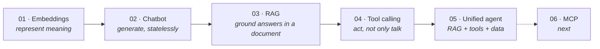

# LLM Engineering: A Progressive Learning Series

[](https://github.com/EmrahTuncBorn/llm-engineering-series/actions/workflows/tests.yml)


*[Türkçe](README.tr.md)*

Five LLM applications built one layer at a time, from a single embedding call
to an agent that combines retrieval, tools and data analysis. Every project
fixes a limitation of the previous one. Together they show the design
decisions, trade-offs and real bugs behind each step, not only working code.

Built with **LangChain / LangGraph**, **Google Gemini** and **Streamlit**.



| # | Project | What it adds | Limitation it leaves for the next step |
|---|---------|--------------|----------------------------------------|
| 01 | [Embeddings](01-embeddings/) | Text → vectors on the unit sphere; hand-written cosine similarity | Only measures similarity, generates nothing |
| 02 | [Chatbot](02-chatbot/) | Multi-turn chat; memory lives in the app, not the model | Knows only its training data |
| 03 | [RAG](03-rag/) | Answers from an uploaded PDF, with page citations | Can read, but cannot act |
| 04 | [Tool calling](04-tool-calling/) | Calculator, Wikipedia, web search via a ReAct loop | Directive prompt; RAG and data live elsewhere |
| 05 | [Unified agent](05-unified-agent/) | RAG as a tool, safe data analysis on CSVs, neutral prompt | Tools are hard-wired into one app → MCP |

## Highlights

- **Agentic RAG.** In project 05 retrieval is a tool. The model decides *when*
  to read the document and writes the search query itself from the
  conversation, so follow-up questions retrieve the right passages.
- **No arbitrary code execution.** The calculator walks a whitelisted AST
  instead of calling `eval()`, and data analysis uses a fixed set of pandas
  operations exposed through an `enum` schema instead of a code interpreter.
- **A real concurrency bug, solved.** LangGraph runs tools in a thread pool,
  where Streamlit's `session_state` is unreachable. The fix and the failed
  first attempt are documented in [05-unified-agent](05-unified-agent/#the-thread-safety-bug).
- **Geometry of embeddings.** Gemini vectors live on $S^{3071}$. The series
  keeps every vector on the unit sphere, even with Matryoshka truncation, so
  cosine similarity equals the dot product
  ([details](01-embeddings/#the-geometry)).
- **Tested without an API key.** 72 offline tests use scripted fake models,
  drive the real LangGraph agent loop and run the Streamlit apps end to end.
  CI runs them on every push.

## Quick start

```bash
git clone https://github.com/EmrahTuncBorn/llm-engineering-series.git
cd llm-engineering-series
python -m venv .venv && source .venv/bin/activate   # Windows: .venv\Scripts\activate
pip install -r requirements.txt

cp .env.example .env        # then add your GOOGLE_API_KEY (free at aistudio.google.com/apikey)

python 01-embeddings/embeddings_demo.py
streamlit run 02-chatbot/app.py
streamlit run 03-rag/app.py
streamlit run 04-tool-calling/app.py
streamlit run 05-unified-agent/app.py
```

Web search in 04 and 05 is optional: add a `TAVILY_API_KEY` to enable it.

## Repository layout

```
llm-engineering-series/
├── llm_series/            shared package used by every project
│   ├── config.py          Gemini chat + embedding models, read from .env
│   ├── safe_math.py       AST-based calculator (replaces eval)
│   ├── documents.py       PDF/CSV ingestion, vector store lifecycle
│   └── chat.py            history trimming and rendering helpers
├── 01-embeddings/ … 05-unified-agent/
├── tests/                 offline test suite (fake models, no key needed)
└── .github/workflows/     CI
```

Shared code lives in one package so that a model name, the embedding size or
a bug fix changes in exactly one place.

## Tests

```bash
pip install -r requirements-dev.txt
pytest -q
```

No key and no network: models are replaced by LangChain's fake chat models,
which can request tool calls. The suite covers the safe calculator (including
injection attempts and `9**9**9`), every `analyze_data` operation, PDF
ingestion and document replacement, Turkish-style CSVs, history trimming,
and each Streamlit app end to end.

A separate smoke test checks what only the real service can confirm: model
names, embedding geometry, multi-turn tool calling with Gemini's thought
signatures, and agentic RAG with real embeddings (about 15 API calls):

```bash
python scripts/smoke_test.py
```

## Configuration

All settings come from `.env` (see [`.env.example`](.env.example)):

| Variable | Default | Purpose |
|----------|---------|---------|
| `GOOGLE_API_KEY` | — | Gemini API key (required) |
| `GEMINI_CHAT_MODEL` | `gemini-3.8-flash` | Chat model |
| `GEMINI_EMBEDDING_MODEL` | `gemini-embedding-001` | Embedding model |
| `GEMINI_EMBEDDING_DIM` | empty (3072) | Matryoshka truncation, 128–3072 |
| `TAVILY_API_KEY` | — | Optional web search |

Temperature is intentionally left unset: Google recommends the default
sampling parameters for Gemini 3 models.

## Roadmap

**06 · MCP (Model Context Protocol).** Expose the tools through a standard
protocol instead of hard-wiring them into each app: first connect as a client
to a local filesystem server, then write a calculator MCP server, then combine
both. Planned after that: multi-step planning with LangGraph, long-term
memory, and evaluation (tool-selection accuracy, RAG faithfulness).

## Background

The projects started during a software engineering internship (August 2026)
and were later refactored for publication. My background is in differential
geometry (MS and PhD), which is why the embedding sections lean on geometry.

## License

[MIT](LICENSE)
