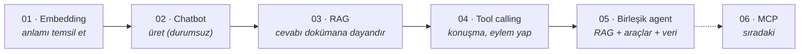

# LLM Mühendisliği: Aşamalı Öğrenme Serisi

*[English](README.md)*

Tek bir embedding çağrısından, geri getirme (retrieval), araçlar ve veri
analizini birleştiren bir agent'a kadar katman katman inşa edilmiş beş LLM
uygulaması. Her proje bir öncekinin bir eksiğini çözüyor. Seri yalnızca
çalışan kodu değil, her adımın arkasındaki tasarım kararlarını, ödünleşimleri
(trade-off) ve gerçek hataları da gösteriyor.

**LangChain / LangGraph**, **Google Gemini** ve **Streamlit** ile geliştirildi.



| # | Proje | Ne ekliyor | Bir sonraki adıma bıraktığı eksik |
|---|-------|------------|-----------------------------------|
| 01 | [Embedding](01-embeddings/) | Metin → birim küre üzerinde vektör; elle yazılmış cosine similarity | Sadece benzerlik ölçüyor, üretmiyor |
| 02 | [Chatbot](02-chatbot/) | Çok turlu sohbet; hafıza modelde değil, uygulamada | Yalnızca eğitim verisini biliyor |
| 03 | [RAG](03-rag/) | Yüklenen PDF'ten sayfa referanslı cevap | Okuyabiliyor ama eylem yapamıyor |
| 04 | [Tool calling](04-tool-calling/) | ReAct döngüsüyle hesap makinesi, Wikipedia, web araması | Yönlendirici prompt; RAG ve veri ayrı yerlerde |
| 05 | [Birleşik agent](05-unified-agent/) | Araç olarak RAG, CSV'de güvenli veri analizi, nötr prompt | Araçlar tek uygulamaya gömülü → MCP |

## Öne çıkanlar

- **Agentic RAG:** 05'te geri getirme bir araç. Dokümana *ne zaman*
  bakılacağına model karar veriyor ve arama sorgusunu sohbetten kendisi
  yazıyor. Bu sayede takip soruları doğru pasajları getiriyor.
- **Serbest kod çalıştırma yok:** Hesap makinesi `eval()` yerine beyaz listeli
  bir AST üzerinden çalışıyor. Veri analizi code interpreter yerine `enum`
  şemasıyla sunulan sabit pandas işlemleri kullanıyor.
- **Çözülmüş gerçek bir eşzamanlılık (concurrency) hatası:** LangGraph araçları
  bir thread havuzunda çalıştırıyor ve orada Streamlit'in `session_state`'ine
  erişilemiyor. Çözüm ve başarısız ilk deneme
  [05-unified-agent](05-unified-agent/#the-thread-safety-bug) içinde anlatılıyor.
- **Embedding'lerin geometrisi:** Gemini vektörleri $S^{3071}$ üzerinde. Seri,
  Matryoshka ile boyut küçültüldüğünde bile tüm vektörleri birim kürede
  tutuyor; böylece cosine similarity = dot product eşitliği korunuyor.
- **API anahtarı olmadan test:** 72 çevrimdışı test, senaryolu sahte modellerle
  gerçek LangGraph agent döngüsünü çalıştırıyor ve Streamlit uygulamalarını
  uçtan uca test ediyor. CI her push'ta bunları çalıştırıyor.

## Hızlı başlangıç

```bash
git clone https://github.com/EmrahTuncBorn/llm-engineering-series.git
cd llm-engineering-series
python -m venv .venv && source .venv/bin/activate   # Windows: .venv\Scripts\activate
pip install -r requirements.txt

cp .env.example .env        # GOOGLE_API_KEY'i ekleyin (ücretsiz: aistudio.google.com/apikey)

python 01-embeddings/embeddings_demo.py
streamlit run 02-chatbot/app.py
streamlit run 03-rag/app.py
streamlit run 04-tool-calling/app.py
streamlit run 05-unified-agent/app.py
```

04 ve 05'teki web araması isteğe bağlı; açmak için `TAVILY_API_KEY` ekleyin.

## Testler

```bash
pip install -r requirements-dev.txt
pytest -q
```

Anahtar ve ağ bağlantısı gerekmiyor.

## Arka plan

Projeler bir yazılım mühendisliği stajı sırasında (Ağustos 2026) başladı ve
yayın için yeniden düzenlendi. Diferansiyel geometri (yüksek lisans ve
doktora) geçmişim, embedding bölümlerinin geometriye yaslanmasının nedeni.

Proje bazında ayrıntılı dokümantasyon İngilizcedir.

## Lisans

[MIT](LICENSE)
